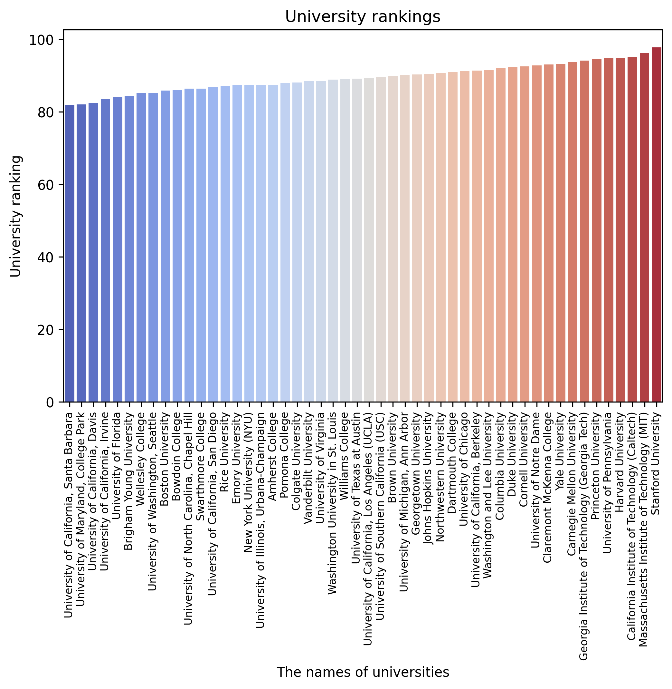

# Top 50 US Universities: Exploratory Data Analysis & Visual Insights

## 📌 Overview
This repository contains a modular exploratory data analysis (EDA) pipeline that profiles and evaluates structural patterns within the top 50 universities in the United States. The system automates data profiling, architectural validation, and statistical reporting while generating a comprehensive visual suite comparing institutional types, employment rates, and academic research impact.

## 🛠️ Tech Stack
- **Language:** Python 3.10+
- **Data Engineering & Analytics:** Pandas, NumPy
- **Data Visualization:** Seaborn, Matplotlib
- **Reporting:** Automation with Contextlib Stdout Redirection

## 🏗️ Pipeline Functionality
The pipeline handles programmatic execution of data profiling and asset generation across three main layers:
1. **Data Ingestion & Integrity Check:** Loads tracking attributes, validates structural schema data types, monitors row duplicates, and profiles null/missing values.
2. **Visual Analytics Engine:** Renders publication-grade statistical charts analyzing multi-attribute distributions:
   - Institutional employment rate benchmarking (Bar & Scatter plots).
   - Historical longevity profiling based on establishment eras.
   - Core research impact scores evaluation.
   - Market share comparisons (Private vs. Public sector employment metrics via adjusted Pie charts).
3. **Automated Reporting:** Generates a persistent execution summary report inside local files, routing standard terminal stream output directly to structural text assets.

## ⚙️ Repository Structure
The project maintains a production-grade decoupled file schema:
- `Graphs/` — Local storage for automated data visualization exports (`.png`).
- `Report/` — Generated markdown/text files storing data-integrity audit logs (`Report_university`).
- `50_Universities_in_America.csv` — Primary processed transactional market dataset.
- `main.py` — Core execution orchestrator script.

## 🚀 How to Run

1. **Clone the repository:**
   ```bash
   git clone https://github.com
   cd us-universities-analytics
   ```

2. **Install requirements:**
   ```bash
   pip install pandas matplotlib seaborn
   ```

3. **Run the analysis pipeline:**
   ```bash
   python main.py
   ```

## 📊 Sample Visual Analytics Insights
Below are the key institutional trend charts generated dynamically by the analytics engine:

### 1. Employment Rate Benchmarking (Bar Chart)


### 2. University Rating Analytics (Scatter Plot)


### 3. Historical Longevity Profiles (Year of Foundation)


### 4. Academic Research Impact Scores


### 5. Institutional Employment Metrics


### 6. Employment Comparison by Institute Type (Bar Plot)


### 7. Private vs. Public Sector Market Distribution (Pie Chart)

